# Transit Lakehouse: feature demo

Every screenshot here comes from the running system, captured Oct 21, 2026 with [`capture.py`](capture.py). For a visual walkthrough, open [`index.html`](index.html) in a browser.

**Demo video (61 s, with narration):** [transit-lakehouse-demo.mp4](transit-lakehouse-demo.mp4). It's built from real recordings of the running system with Playwright, an edge-tts voiceover, and Remotion; see [`demo/video/`](../../demo/video/).

**The question:** which MBTA routes are chronically late, by how much, and at what time of day?

```
MBTA GTFS-realtime ─▶ poller ─▶ Redpanda (Kafka) ─▶ Spark bronze ─▶ Iceberg bronze
                                                         └▶ Spark silver (join + 15-min watermark) ─▶ Iceberg silver
                                       dbt (gold) ◀── Airflow every 15 min + 39 quality gates ──▶ Prometheus / Grafana
```

---

## 1. The answer: gold `chronically_late_routes`

These rows come from about 300k observed stop visits across 3 service days.

| # | Route | Stop visits | Avg late | > 5 min late | Worst hour |
|---|---|---:|---:|---:|---:|
| 1 | 37 | 1,057 | 14.1 min | 78% | 5 PM |
| 2 | 131 | 508 | 9.0 min | 70% | 6 PM |
| 3 | 217 | 290 | 8.6 min | 37% | 4 PM |
| 4 | 36 | 1,797 | 8.0 min | 55% | 1 AM |
| 5 | 505 | 387 | 7.9 min | 55% | 5 PM |

**Buses are latest in the evening rush:** 5.4 min late at 6 PM, against 1.5 min after midnight. Source: `gold.route_lateness_by_hour`.

```powershell
docker compose exec spark python sql.py "SELECT lateness_rank, route_name, round(avg_delay_s/60,1) AS avg_late_min, worst_hour_of_day FROM gold.chronically_late_routes ORDER BY lateness_rank LIMIT 10"
```

## 2. Live feed into Kafka

The poller fetches MBTA's protobuf feeds every 15 seconds. It validates and timestamps each record and produces JSON to Redpanda, keyed by route. Failures go to `*.dlq`.

| Topics | Live messages |
|---|---|
| 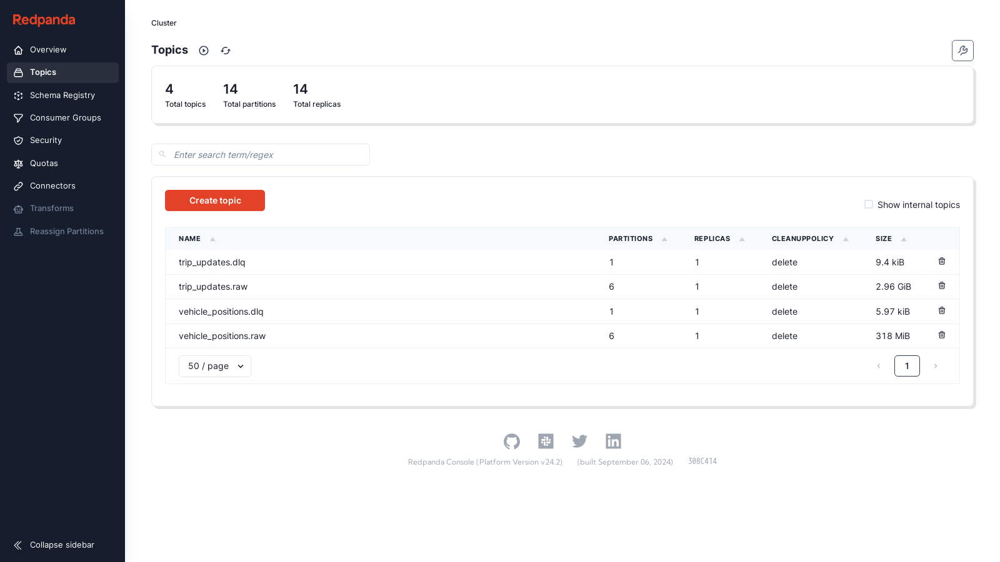 | 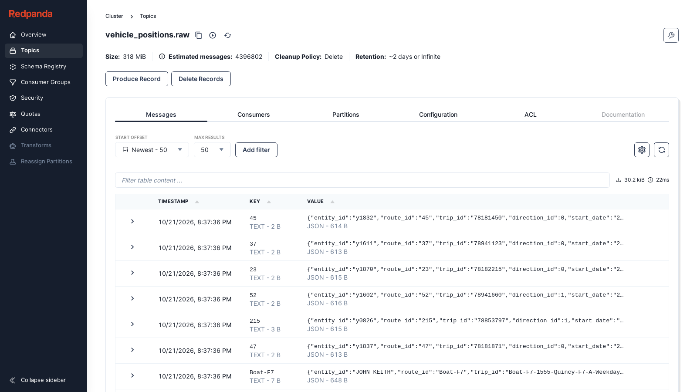 |

**Try it:** Kafka console at http://localhost:8080, `docker logs -f poller`, and metrics at http://localhost:8000/metrics.

## 3. Bronze: exactly what arrived (Spark → Iceberg on MinIO)

A Spark Structured Streaming job writes both topics to Iceberg every 10 seconds. Each row keeps its Kafka partition and offset, and a `kill -9` left 0 duplicate offsets.

| Spark streaming queries | Lakehouse on MinIO |
|---|---|
| 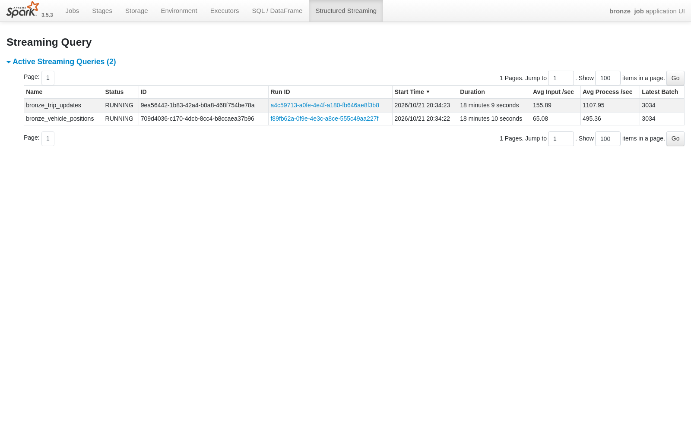 | 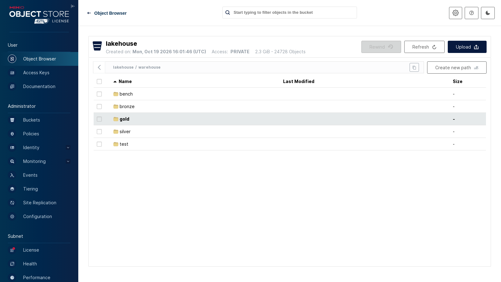 |

**Try it:** `docker compose exec spark python sql.py "SELECT count(*) FROM bronze.vehicle_positions"`. The Spark UI is at http://localhost:4040 and MinIO at http://localhost:9001.

## 4. Silver: a delay for every stop

The observed arrival is the **last prediction before the stop drops out of the feed**. That's joined to the day's timetable, and times like `25:10:00` are handled correctly. A **15-minute watermark** makes late events count: reordered replays gave identical output, and 20-minute-late events were dropped and counted. Compared with GPS, **99.6% of arrivals were within 60 s**.

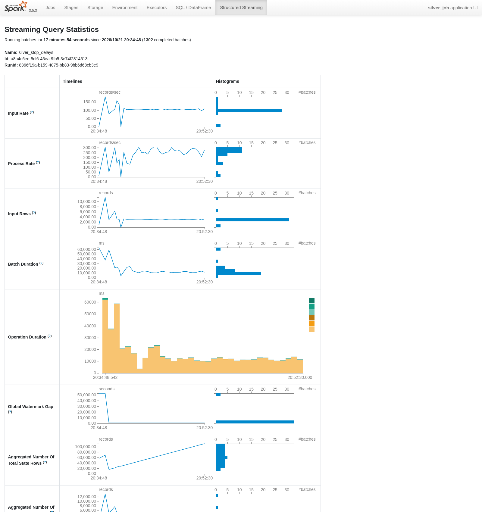

## 5. Gold: dbt models and lineage

| Lineage: silver → gold | Model docs |
|---|---|
| 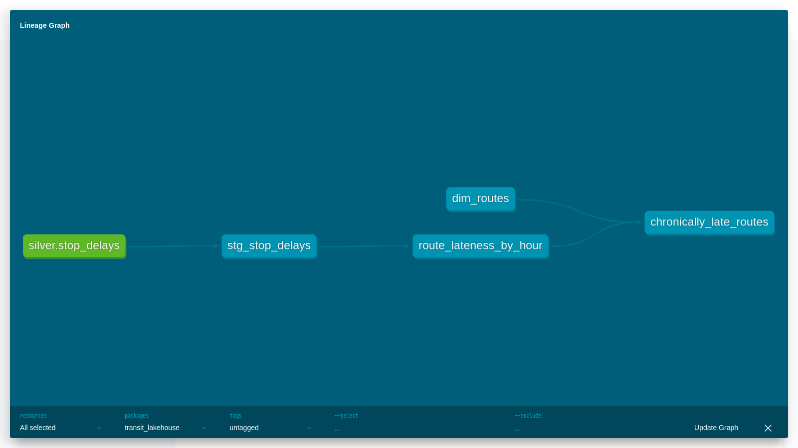 | 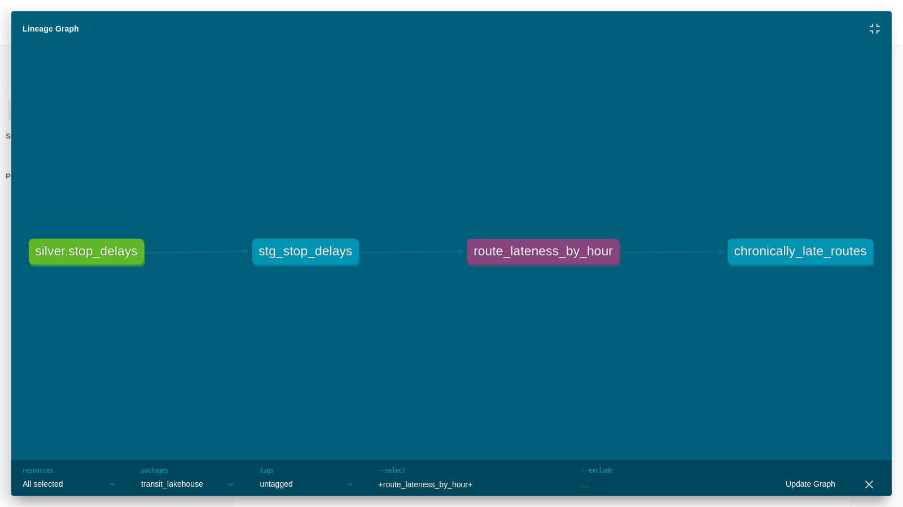 |

**Try it:** `docker compose run --rm dbt dbt build`, then `dbt docs serve` (see the README).

## 6. Quality gates (24 dbt tests and 15 Great Expectations checks)

```powershell
docker compose run --rm dbt python /work/quality/bad_row_drill.py
#   [PASS] dbt test fails on bad row
#   [PASS] great_expectations fails on bad row
#   [PASS] dbt test passes after cleanup
#   [PASS] great_expectations passes after cleanup
```

The gates caught two real bugs: a duplicated stop visit, and a stale aggregate left in gold.

## 7. Airflow: every 15 minutes, red on any failure

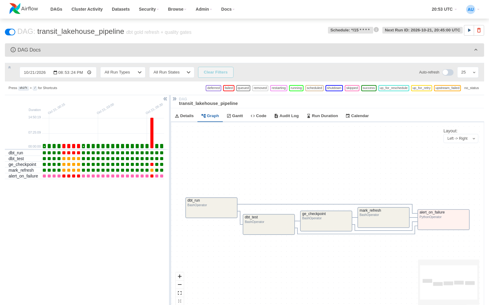

| DAGs | Hourly Iceberg maintenance |
|---|---|
| 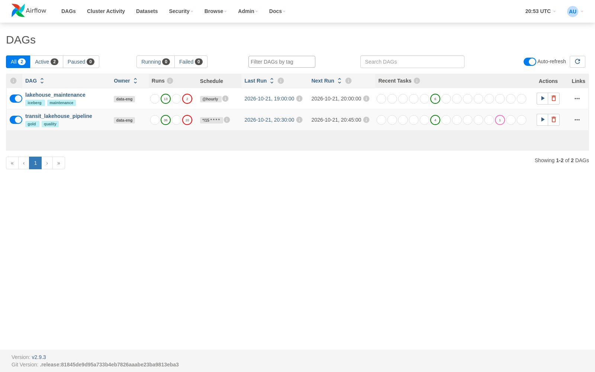 | 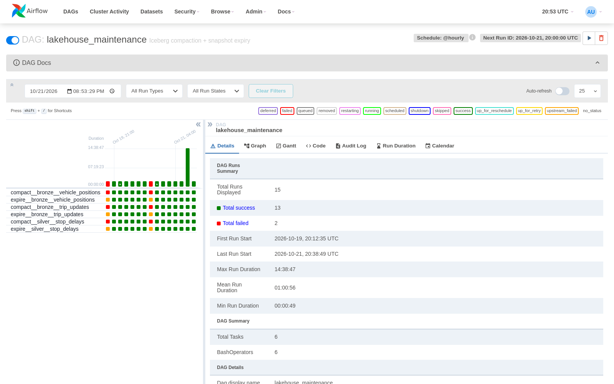 |

**Try it:** http://localhost:8081 (admin / admin).

## 8. Observability: Prometheus and Grafana

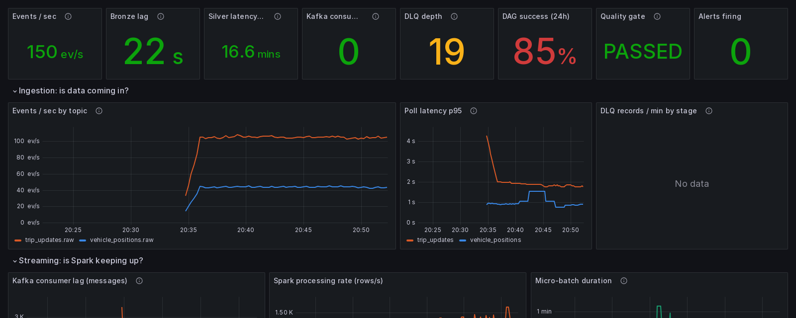

| Streaming and latency | State and orchestration |
|---|---|
| 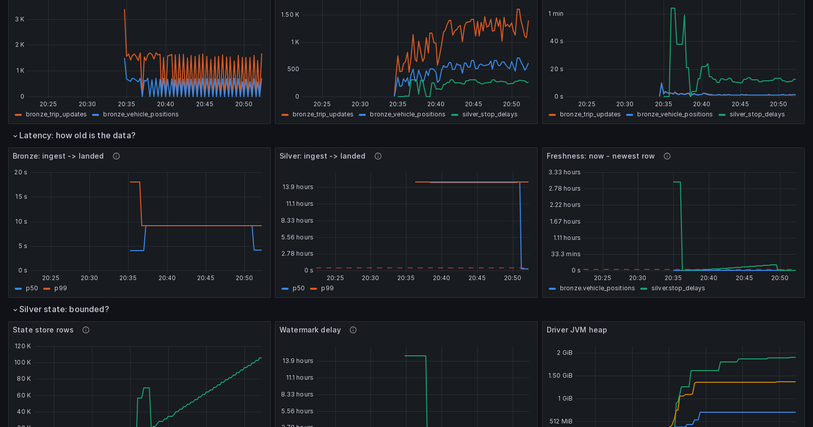 | 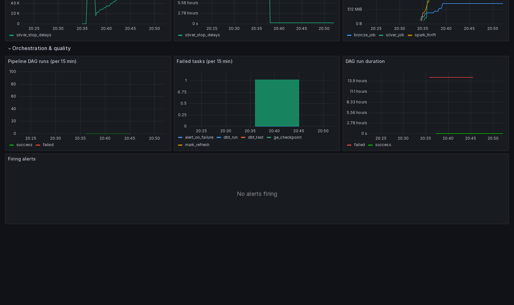 |

| 6 alert rules | All targets up |
|---|---|
| 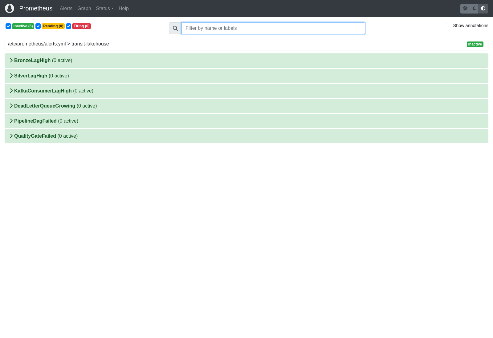 | 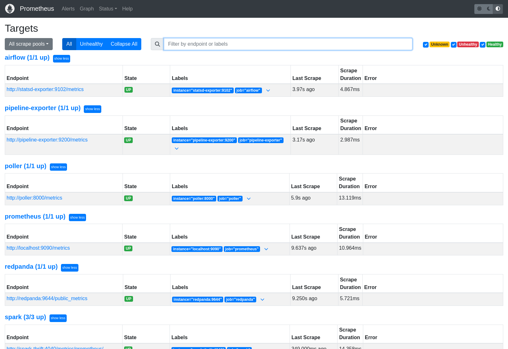 |

## 9. Failure drills

| Poller paused: lag climbs, alert fires, the source is diagnosed | Forced quality failure: DAG red, alerts fire |
|---|---|
| 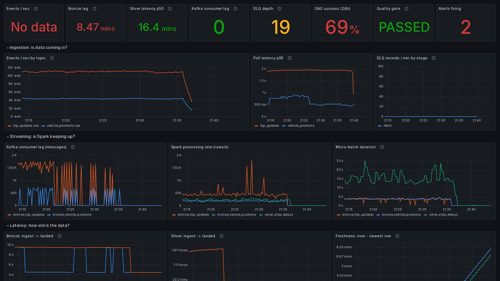 | 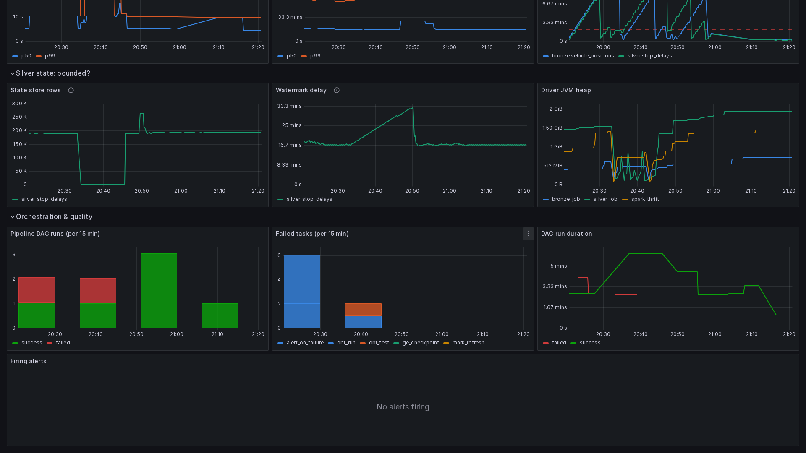 |

```powershell
docker compose stop poller ; docker compose start poller
docker compose run --rm dbt python /work/quality/inject_bad_row.py inject   # then: ... remove
```

## 10. Load test, recovery, partitioning, and Kubernetes

The full numbers are in [`scripts/results/phase6_perf.md`](../../scripts/results/phase6_perf.md) and [`k8s/results/`](../../k8s/results/).

- **Throughput:** 2k → 10k events/s sustained, after fixing a single-threaded write
- **Latency:** p50 5.0 s and p99 9.9 s from ingest to bronze
- **Recovery:** 32 s for bronze and 101 s for silver after 5 minutes down
- **Partitioning:** 1.9× faster for one route over 7 days
- **Kubernetes:** every pod Running on kind, an HPA on the SQL server, and a CrashLoopBackOff drill

---

To recapture these screenshots, start the stack and let it settle (about 20 min), then run:

```bash
docker run --rm --network transit-lakehouse_default -v "$PWD/docs/demo:/demo" \
  mcr.microsoft.com/playwright/python:v1.48.0-jammy \
  sh -c "pip install -q playwright==1.48.0 && python /demo/capture.py"
```
